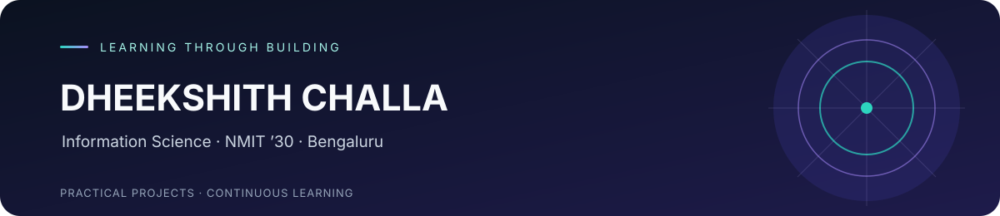

  
  
<strong>Hi, I’m Dheekshith.</strong> I’m learning by building practical software projects and improving them through hands-on work.

  
<a href="https://www.linkedin.com/in/dheekshith-challa-216aa33bb/">LinkedIn</a> · <a href="https://github.com/DheekshithChalla">GitHub</a>

## About

I’m an Information Science student at **Nitte Meenakshi Institute of Technology (NMIT), Class of 2030**, in Bengaluru. I completed **Harvard’s CS50x: Introduction to Computer Science** and am currently practicing C++, Python, data structures, databases, and web development through coursework and projects.

## Projects

### 🍽️ [BatchOptima KDS](https://github.com/DheekshithChalla/BatchOptima-KDS)
A kitchen batching dashboard prototype built for SpeedCode 2026. It groups incoming orders by delivery zone and time window, then splits batches when they reach the item limit. The project received a **Certificate of Appreciation**.

[Open the demo](https://dheekshithchalla.github.io/BatchOptima-KDS/) · [View the code](https://github.com/DheekshithChalla/BatchOptima-KDS)

### 🌿 [ArthaOS](https://github.com/DheekshithChalla/artha.ai-OS)
A personal finance prototype built for Arthathon 2026. It explores budgeting, tax comparisons, and scam awareness in a browser-based app.

**Build note:** I used Google Antigravity for coding assistance. I made the project and feature decisions, and worked on integration and final testing.

[Open the demo](https://dheekshithchalla.github.io/artha.ai-OS/) · [View the code](https://github.com/DheekshithChalla/artha.ai-OS)

## Courses & job simulations

- **CS50x: Introduction to Computer Science** — Harvard University (completed)
- **Google Prompting Essentials Specialization** — Coursera
- **Python course completion** — Kaggle
- **Data Science Job Simulation** — BCG X, via Forage
- **Data Analytics Virtual Job Simulation** — Deloitte, via Forage

## Currently learning

C++ · Python · Data structures · Databases · Web development

---

Always learning, building, and happy to connect.

